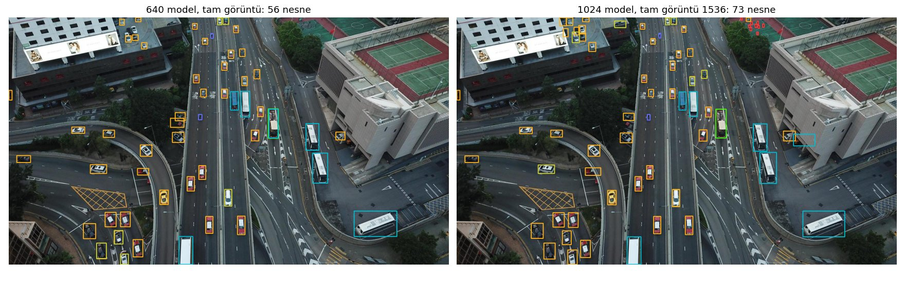
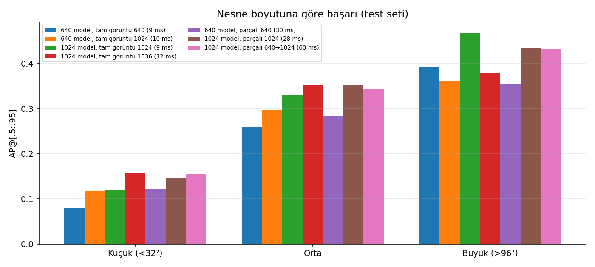
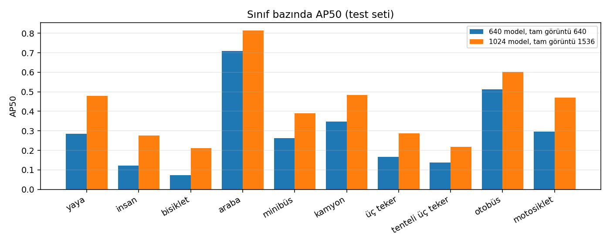
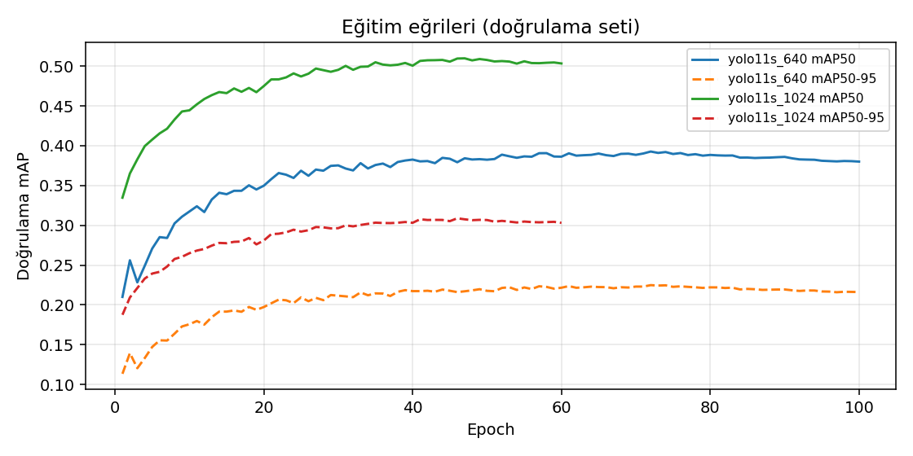

# Drone Görüntülerinde Küçük Nesne Tespiti

Drone'dan çekilmiş görüntülerde yaya, araba, minibüs, kamyon, otobüs, motosiklet gibi 10 sınıf nesneyi bulan
bir tespit sistemi. Asıl zorluk nesnelerin çok küçük olması: test setindeki nesnelerin %68'i 32x32 pikselden küçük,
ve ~1400x800'lük görüntü 640'a küçültülünce bir yaya birkaç piksele iniyor.

Bu projede şu soruya cevap aradım: **küçük nesneler için çözünürlüğü artırmak mı, görüntüyü parçalara bölüp
taramak mı daha iyi, ve hızdan ne kadar kaybediliyor?**

- YOLO11s (COCO'da önceden eğitilmiş) VisDrone üzerinde iki çözünürlükte ince ayarla eğitildi: 640 ve 1024
- Parçalı tarama (slicing) kendi kodum: görüntüyü örtüşen parçalara bölüp her parçayı ayrı tarıyor, kutuları
  birleştirip sınıf bazında NMS ile tekilleştiriyor (`src/dilimleme.py`)
- 7 farklı çıkarım ayarı COCO metrikleriyle, nesne boyutuna göre (küçük / orta / büyük) karşılaştırıldı
- Hız: PyTorch FP32/FP16 ekran kartında, ONNX işlemcide
- FastAPI servisi, Gradio demo, testler, Dockerfile



## Veri

[VisDrone2019-DET](https://github.com/VisDrone/VisDrone-Dataset): 6.471 eğitim, 548 doğrulama, 1.610 test (test-dev)
görüntüsü; toplam ~457 bin etiketli nesne. "Yok sayılan bölge" ve "diğer" etiketli kutuları çıkardım. Ayar seçimleri
doğrulama setinde yapıldı, aşağıdaki tablolar test-dev setinde.

## Sonuçlar (test-dev, 1.610 görüntü)

| Model | Çıkarım | AP | AP50 | AP küçük | AP orta | AP büyük | Süre |
| --- | --- | --- | --- | --- | --- | --- | --- |
| 640 | tam görüntü, 640 | 0,168 | 0,291 | 0,080 | 0,259 | 0,391 | 9 ms |
| 640 | tam görüntü, 1024 | 0,202 | 0,354 | 0,117 | 0,297 | 0,360 | 10 ms |
| 640 | parçalı (640'lık parçalar) | 0,202 | 0,354 | 0,122 | 0,283 | 0,354 | 30 ms |
| 1024 | tam görüntü, 1024 | 0,221 | 0,382 | 0,119 | 0,332 | **0,468** | 9 ms |
| 1024 | **tam görüntü, 1536** | **0,248** | 0,423 | **0,157** | **0,353** | 0,379 | **12 ms** |
| 1024 | parçalı (1024'lük parçalar) | 0,245 | 0,419 | 0,147 | 0,353 | 0,434 | 28 ms |
| 1024 | parçalı (640'lık parçalar 1024'e büyütülerek) | **0,248** | **0,425** | 0,156 | 0,343 | 0,432 | 60 ms |

AP: COCO AP@[.5:.95], görüntü başına en fazla 500 tespit. Süre: RTX 5070 Ti, görüntü başına, ön ve son işleme dahil.



### Ne öğrendim

- **Çözünürlük en önemli etken.** Küçük nesnelerde AP 0,080'den (640) 0,157'ye (1536) çıkıyor, yani iki katına.
  Hız ise 9 ms'den 12 ms'ye çıkıyor, neredeyse aynı.
- **Parçalı tarama işe yarıyor ama bu durumda en iyi seçenek değil.** 640 modelinde küçük nesne AP'sini 0,080'den
  0,122'ye çıkarıyor, ama aynı modeli tam görüntüde 1024 ile çalıştırmak da hemen hemen aynı sonucu (0,117) üç kat
  hızlı veriyor. 1024 modelinde en iyi parçalı ayar ile tam görüntü 1536 aynı AP'yi veriyor, ama parçalı olan
  5 kat yavaş. Parçalı tarama, görüntü ekran kartı belleğine sığmayacak kadar büyük olduğunda (ör. 4K, uydu)
  anlamlı hale gelir.
- **Büyük nesnelerde ters etki:** 1536'da büyük nesnelerin AP'si düşüyor (0,468 → 0,379); model eğitimde bu
  boyutlarda nesne görmedi. Parçalı ayarlarda tam görüntü taraması da eklendiği için büyük nesneler korunuyor.
  Servis bu yüzden tam görüntü 1536'yı varsayılan yapıyor, parçalı taramayı seçenek olarak sunuyor.
- **Zor sınıflar:** araba AP50 0,81 ve otobüs 0,60 iken bisiklet (0,21), tenteli üç teker (0,22) ve oturan/duran
  insan (0,28) zor. Hem çok küçükler hem de eğitimde az örnekleri var.



### Hız

| Model | Biçim | Süre | FPS |
| --- | --- | --- | --- |
| 640 | PyTorch FP32, ekran kartı | 8,8 ms | 113 |
| 640 | PyTorch FP16, ekran kartı | 6,1 ms | 163 |
| 640 | ONNX Runtime, işlemci | 21,7 ms | 46 |
| 1024 | PyTorch FP32, ekran kartı | 9,8 ms | 102 |
| 1024 | PyTorch FP16, ekran kartı | 7,3 ms | 137 |
| 1024 | ONNX Runtime, işlemci | 71,4 ms | 14 |

Ekran kartı olmayan bir saha bilgisayarında 640 model ONNX ile gerçek zamanlıya yakın (46 FPS) çalışıyor.

### Eğitim

| Model | Epoch | Batch | Süre (RTX 5070 Ti) | Doğrulama mAP50 / mAP50-95 |
| --- | --- | --- | --- | --- |
| YOLO11s, 640 | 100 | 16 | ~1 saat | 0,393 / 0,225 |
| YOLO11s, 1024 | 60 | 8 | ~1,3 saat | 0,510 / 0,309 |

(Son sütun Ultralytics'in kendi doğrulama ölçümü; yukarıdaki tablolardaki COCO değerlendirmesi biraz farklı ayarlarla yapıldı.)



## API ve demo

```bash
uvicorn api.app:app            # http://127.0.0.1:8000/docs
python demo.py                 # http://127.0.0.1:7860
```

| Uç nokta | Açıklama |
| --- | --- |
| `POST /tespit` | Görüntüdeki nesneler, sınıf sayımları (`parcali`, `esik` parametreleri) |
| `POST /tespit/gorsel` | Kutular çizilmiş JPEG |

```bash
curl -F "dosya=@ornekler/drone_2.jpg" http://127.0.0.1:8000/tespit
```
```json
{"toplam": 73, "sayim": {"araba": 46, "yaya": 9, "minibüs": 8, "otobüs": 7, "motosiklet": 2, "kamyon": 1},
 "nesneler": [{"sinif": "otobüs", "skor": 0.914, "kutu": [943.3, 339.1, 987.9, 426.5]}, "..."]}
```

Docker ile (CPU):

```bash
docker build -t drone-tespit .
docker run -p 8000:8000 drone-tespit
```

## Çalıştırma

```bash
python -m venv .venv
.venv\Scripts\activate          # Linux/macOS: source .venv/bin/activate
pip install -r requirements.txt
```

Eğitilmiş modeller `models/` altında. Baştan üretmek için VisDrone2019-DET zip dosyalarını `data/indirme/` altına koyun:

```bash
python -m src.veri                                   # YOLO ve COCO formatına çevirme
python -m src.egit --imgsz 640 --epochs 100 --ad yolo11s_640
python -m src.egit --imgsz 1024 --epochs 60 --batch 8 --ad yolo11s_1024
python -m src.degerlendir --bolum test               # 7 çıkarım ayarı
python -m src.hiz                                    # hız ve ONNX
python -m src.grafikler
pytest
```

## Klasör yapısı

```
src/
  veri.py          VisDrone -> YOLO ve COCO formatı
  egit.py          YOLO11 ince ayar
  dilimleme.py     parçalı tarama ve birleştirme
  degerlendir.py   COCO metrikleri, boyuta ve sınıfa göre AP
  hiz.py           ONNX'e aktarma ve hız ölçümü
  cikarim.py       tek görüntü tespiti (API ve demo için)
  grafikler.py     README grafikleri
api/app.py         FastAPI servisi
demo.py            Gradio arayüzü
models/            eğitilmiş ağırlıklar
reports/           sonuç tabloları, eğitim kayıtları, grafikler
```

## Sınırlamalar

- Değerlendirmede "yok sayılan bölgeleri" maskelemek yerine o kutuları çıkardım; bu yüzden sonuçlar VisDrone'un
  resmi değerlendirme aracıyla birebir karşılaştırılamaz.
- Parçaların sınırında kesilen nesneler bazen iki yarım kutu olarak kalabiliyor; NMS yerine kutu birleştirme
  (ör. NMM) bunu azaltabilir.
- Tek bir model boyutu (s) denendi; daha büyük modeller (m, l) daha yüksek AP verir ama daha yavaştır.

## Kaynaklar ve lisanslar

- P. Zhu ve ark. *Detection and Tracking Meet Drones Challenge.* IEEE TPAMI, 2021 (VisDrone).
- F. Akyon ve ark. *Slicing Aided Hyper Inference and Fine-tuning for Small Object Detection.* ICIP 2022 (parçalı tarama fikri).
- Model eğitimi ve çıkarımı [Ultralytics](https://github.com/ultralytics/ultralytics) (AGPL-3.0) ile yapıldı.
- `ornekler/` klasöründeki görüntüler VisDrone test setinden alındı; veri seti yalnızca ticari olmayan araştırma
  amaçlı kullanılabilir.

## Yazar

Batın Dikilitaş, Kocaeli Üniversitesi Yapay Zeka ve Makine Öğrenmesi
